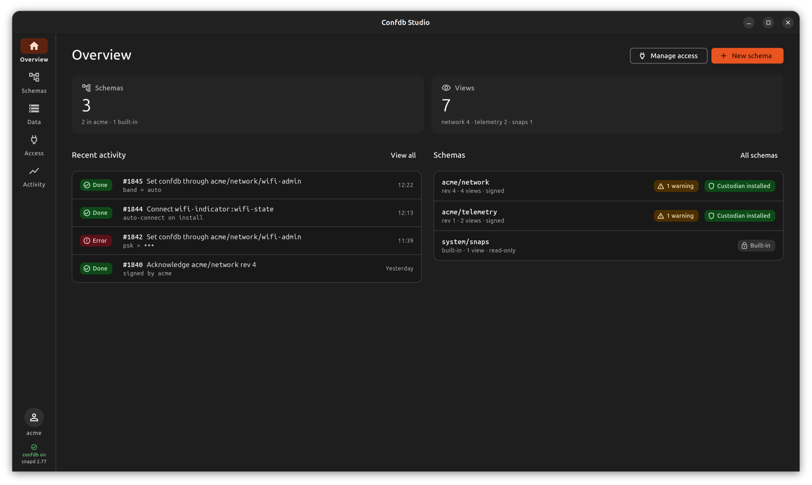
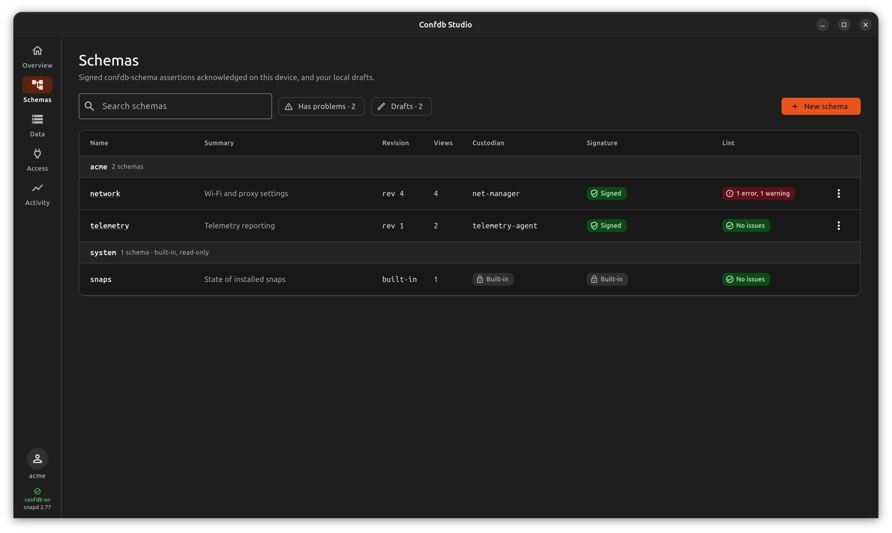
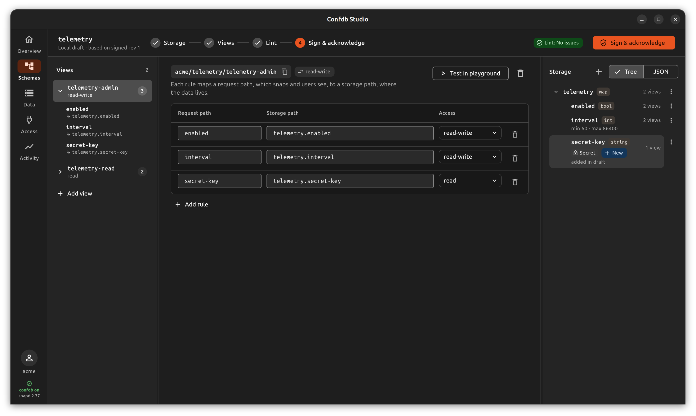
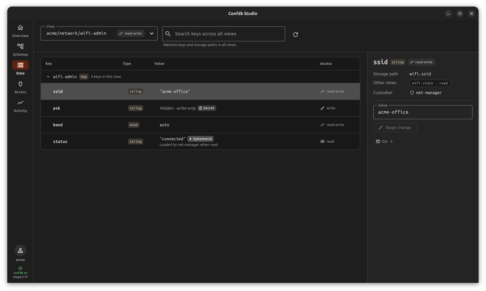
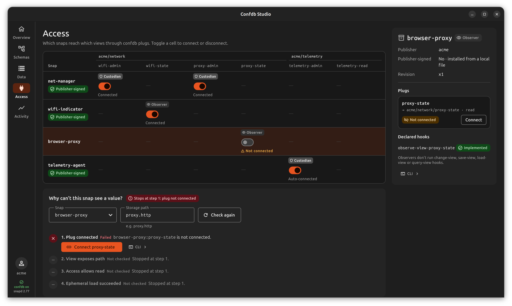

# Confdb Studio

Flutter desktop app for snapd's experimental
**confdb**: browse and edit values through views, author and sign schemas,
manage which snaps reach which views, and follow every change.

## Screenshots

### Overview



### Schemas



### Schema Editor



### Data Explorer



### Access



## Run

```sh
flutter run -d linux                                  # sample data (default)
flutter run -d linux --dart-define=CONFDB_BACKEND=rest   # snapd on /run/snapd.socket
```

## Snap

With Snapcraft installed and its build environment configured, build and install
the snap from the repository root (amd64 example):

```sh
snapcraft pack
sudo snap install --dangerous --classic ./confdb-studio_0.0.1_amd64.snap
snap run confdb-studio
```

## Backends

All data goes through `ConfdbRepository` (`lib/data/confdb_repository.dart`):

- `FakeConfdbRepository`: the sample data. Writes behave like snapd.
  `net-manager`'s change-view hook rejects a psk shorter than 8 characters and
  the change rolls back; observers are notified; IDs continue from #1846.
- `SnapdRepository` over a `SnapdTransport`:
  - `UnixSocketTransport`: HTTP on `/run/snapd.socket`, with
    `X-Allow-Interaction` so polkit can ask for admin authentication.
    Writes snapd refuses there (installing assertions accepts only root) are
    retried as root through `pkexec snap debug api`.
  - `SnapCommandTransport`: `snap debug api`, with `pkexec` for writes.

  Signing uses `snap sign` and `snap keys` (keys live in the user's keyring).

## Tests

```sh
flutter analyze
flutter test                                    # unit + widget tests
flutter test test/visual --update-goldens --dart-define=SCREENSHOTS=/abs/dir
                                                # renders 39 screen states to PNGs
flutter test test/integration --dart-define=SNAPD_IT=true
                                                # read-only checks against local snapd
                                                # (a view read may show a polkit prompt)
```
