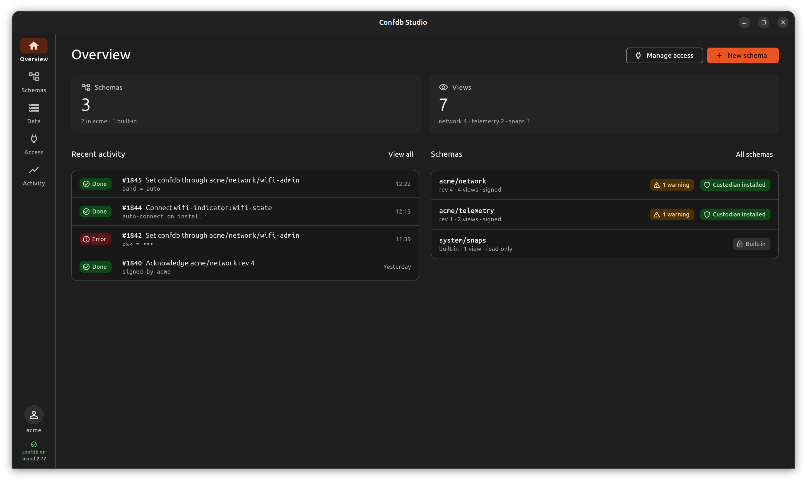
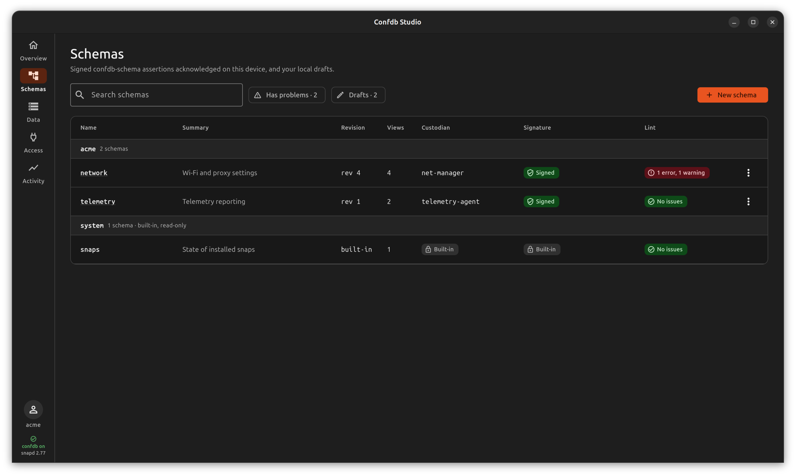
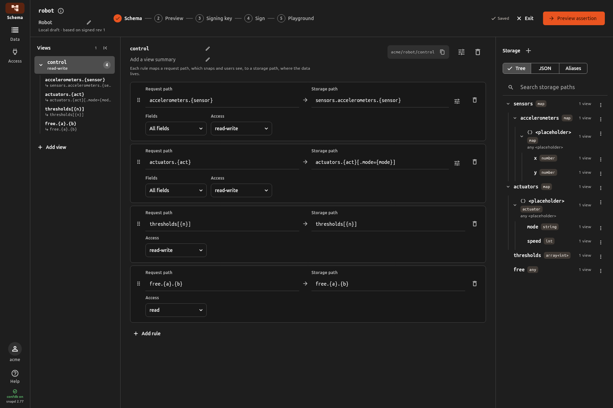
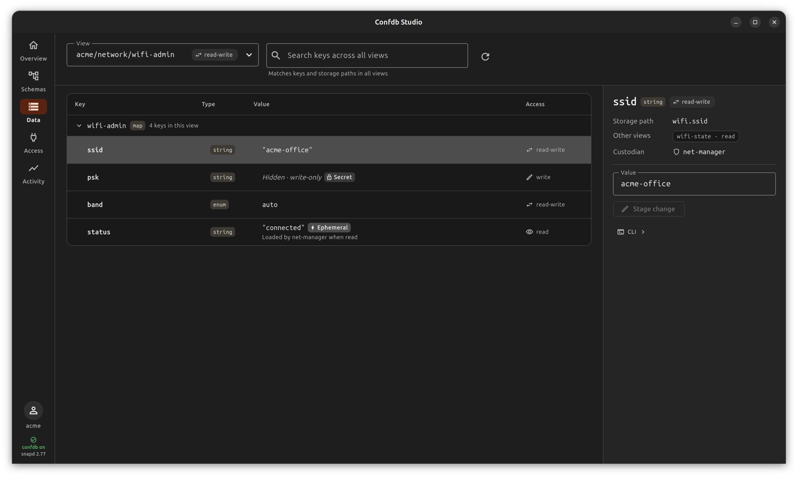
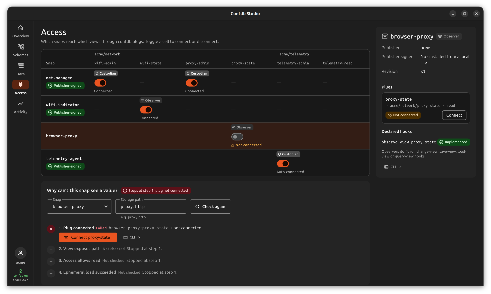

# Confdb Studio

Flutter desktop app for snapd's experimental
**confdb**: browse and edit values through views, author and sign schemas,
manage which snaps reach which views, and follow every change.

## Screenshots

### Overview



### Schemas



### Schema Editor

Each rule card maps a request path to a storage path, with access and (for
maps) field-selection controls below. The Storage pane has separate Tree,
JSON, and Aliases tabs; use Aliases to create and manage reusable types.



### Data Explorer



### Access



## Run

```sh
flutter run -d linux                                  # sample data (default)
flutter run -d linux --dart-define=CONFDB_BACKEND=rest   # snapd on /run/snapd.socket
```

## Snap

With Snapcraft installed and its build environment configured, build and install
the snap from the repository root (amd64 example):

```sh
snapcraft pack
sudo snap install --dangerous --classic ./confdb-studio_0.0.1_amd64.snap
snap run confdb-studio
```

## Backends

All data goes through `ConfdbRepository` (`lib/data/confdb_repository.dart`):

- `FakeConfdbRepository`: the sample data. Writes behave like snapd.
  `net-manager`'s change-view hook rejects a psk shorter than 8 characters and
  the change rolls back; observers are notified; IDs continue from #1846.
- `SnapdRepository` over a `SnapdTransport`:
  - `UnixSocketTransport`: HTTP on `/run/snapd.socket`, with
    `X-Allow-Interaction` so polkit can ask for admin authentication.
    Writes snapd refuses there (installing assertions accepts only root) are
    retried as root through `pkexec snap debug api`.
  - `SnapCommandTransport`: `snap debug api`, with `pkexec` for writes.

  Signing uses `snap sign` and `snap keys` (keys live in the user's keyring).

The Snap Store confdb-schemas API (`SnapStoreClient`,
`lib/data/store/snap_store_client.dart`) talks Ubuntu One SSO login, 2FA, and
macaroon-signed requests through
[`snapstore-auth`](https://github.com/ogra1/snapstore-auth), a native Rust
backend pulled in as a pinned git dependency (see `pubspec.yaml`, not
vendored in this repo) and bound from Dart over `dart:ffi`
(`lib/data/store/snapstore_auth_client.dart`). Build it with
`scripts/build_rust_backend.sh` before `flutter run`/packaging; the saved
login lives in `store.json` under the app data dir.

## Tests

```sh
flutter analyze
flutter test                                    # unit + widget tests
flutter test test/visual --update-goldens --dart-define=SCREENSHOTS=/abs/dir
                                                # renders 39 screen states to PNGs
flutter test test/integration --dart-define=SNAPD_IT=true
                                                # read-only checks against local snapd
                                                # (a view read may show a polkit prompt)
```

### Real snapd integration tests

This suite **replaces the machine's snapd**, so it only runs where the whole
machine is disposable. `scripts/integration/run_suite.sh` does the work in
place; there are two ways to reach it.

**Locally, in a throwaway LXD VM** (your host is never modified):

```sh
# Requires an initialized LXD with VM support (/dev/kvm), an Ubuntu image
# remote, and permission to use lxc. No host Flutter/Go SDK is needed.
./scripts/test_snapd_integration.sh
./scripts/test_snapd_integration.sh --keep       # retain the VM for debugging
./scripts/test_snapd_integration.sh --snapd-ref <tag-commit-or-branch>
```

**In CI**, the `snapd integration` workflow runs `run_suite.sh` directly on the
ephemeral GitHub runner, with `CONFDB_IT_DESTRUCTIVE=1`. No VM is nested inside
the runner, so the job needs no KVM, LXD or firewall setup. Outside those two
cases the script refuses to run: it requires either the VM marker that
`test_snapd_integration.sh` creates or that explicit opt-in, so it cannot
destroy a workstation's snapd by accident.

By default the suite builds snapd's **latest stable release**, resolved at run
time from the GitHub releases API (currently 2.78), so it tracks new snapd
releases without a code change. snapd's tag list is not version-ordered and it
has no `main` branch, so the releases API is the only reliable source; if it
cannot be reached the run stops rather than silently falling back to an older
revision. Pass `--snapd-ref` to build a specific tag, commit or branch (for
example `master` to check upcoming snapd against Studio). The resolved ref and
its exact commit are recorded in `snapd-ref.txt` and `snapd-revision.txt`.

The local runner uploads the current working tree and creates an Ubuntu 24.04
VM (4 CPUs, 8 GiB RAM, 35 GiB disk). Either way the suite builds snapd's Debian
package from that source revision with `DEB_BUILD_OPTIONS="nocheck testkeys parallel=4"`, and
installs it along with `core24` and Flutter 3.47.7. `nocheck` skips snapd's own
unit suite, not Studio's integration tests. Internet access is required for
packages, SDKs and the base snap. Test-key trust, unprotected signing keys and
system changes never leave the disposable machine. Do not install these snapd
packages on a normal machine.

APT repository update failures stop setup immediately. If Docker or another
firewall is active locally, its default `FORWARD` drop can blackhole the LXD
VM's traffic; the local runner deliberately does not edit host firewall rules,
so allow bridge traffic yourself if that happens.

Both Unix-socket and `snap debug api` transports exercise system status and
feature enablement, accounts and schema decoding, draft persistence/import,
typed values and unsets, access rules, secret masking, ephemeral load hooks,
custodian rejection and rollback, observer hooks, snap inventory/connections,
key creation/export, signing, revision advancement and acknowledgement.
Writes and changes must actually complete; fixture/setup errors fail the run.
Tests are skipped during ordinary `flutter test`; `run_suite.sh` enables them
with `SNAPD_IT=true` and the disposable-machine safety marker.

Store authentication and publishing use a deterministic `StoreAuthClient`,
while the real `SnapStoreClient` still performs serialization and session
persistence. A command adapter substitutes only `snap known --remote` with
test-root-signed assertion fixtures; signing, local assertion lookup and
acknowledgement use real snap binaries and snapd. This covers login/2FA/cancel/
logout, key registration, Store key lookup, push-before-ack ordering, rejected
pushes, and installation without credentials or publishing to a live account.
It does **not** validate the public Store service or Rust authentication FFI.
The suite runs as root in the VM; desktop polkit interaction is not covered.

The `snapd integration` workflow runs on pull requests and pushes to `main`
(also manually). Logs, exact snapd revision, change listing and JSON test
events are uploaded even on failure. Locally, diagnostics go to
`build/snapd-integration/`; override with `SNAPD_IT_OUTPUT`.
The VM is deleted on exit unless `--keep` is passed. The retained VM name and
cleanup command are printed. Override Flutter with `FLUTTER_VERSION`.
